# CabBook

**A calmer way to move through the city.** CabBook is a responsive ride-booking prototype for Visakhapatnam, built with Next.js, React, Clerk, SQLite, and Drizzle ORM. Riders can plan trips, review fare estimates, manage ride history, and receive account-scoped updates. An operator-controlled demo driver queue supports the other side of the ride flow.

> **Demo, not a payment service:** fares and travel times are estimates. CabBook does not collect payment details or process payments. Driver matching is a demo queue, not a live dispatch or driver-tracking system.

## Screenshots

The gallery below shows the app in **dark mode** at desktop and mobile widths. Each pair shows the same page at both sizes. These are the only screenshots retained in the repository; they live in [`docs/screenshots/`](docs/screenshots/).

### Home

A public introduction to CabBook with a ride-focused hero, service highlights, and clear paths to sign in or plan a trip.

<p align="center">
  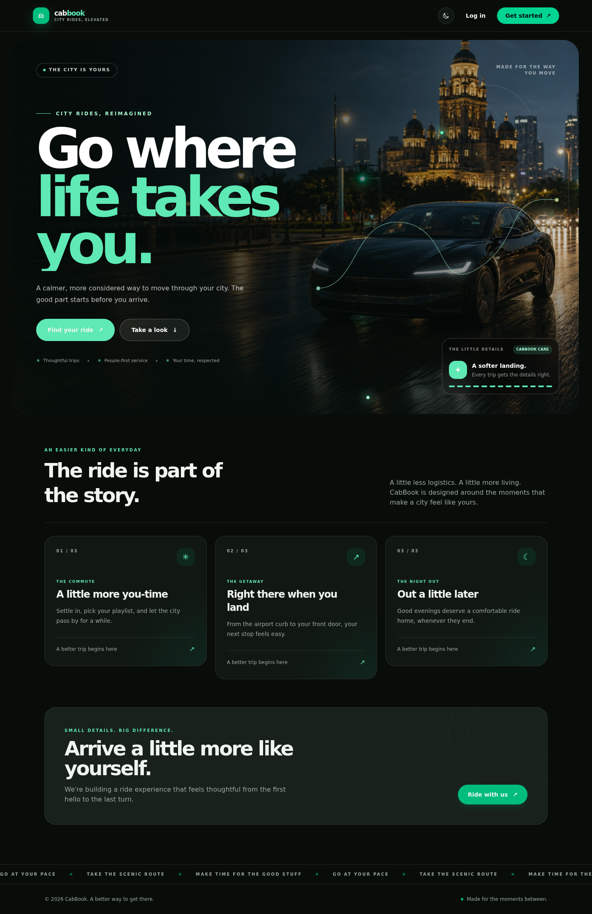
  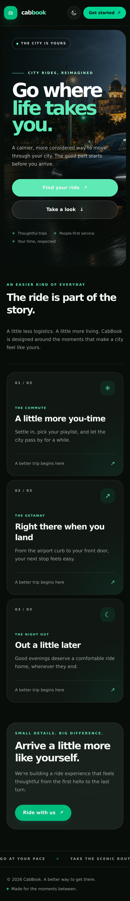
</p>

### Sign in and sign up

Clerk-hosted authentication screens let riders access their account. Social sign-in options depend on the providers enabled for your Clerk application.

<p align="center">
  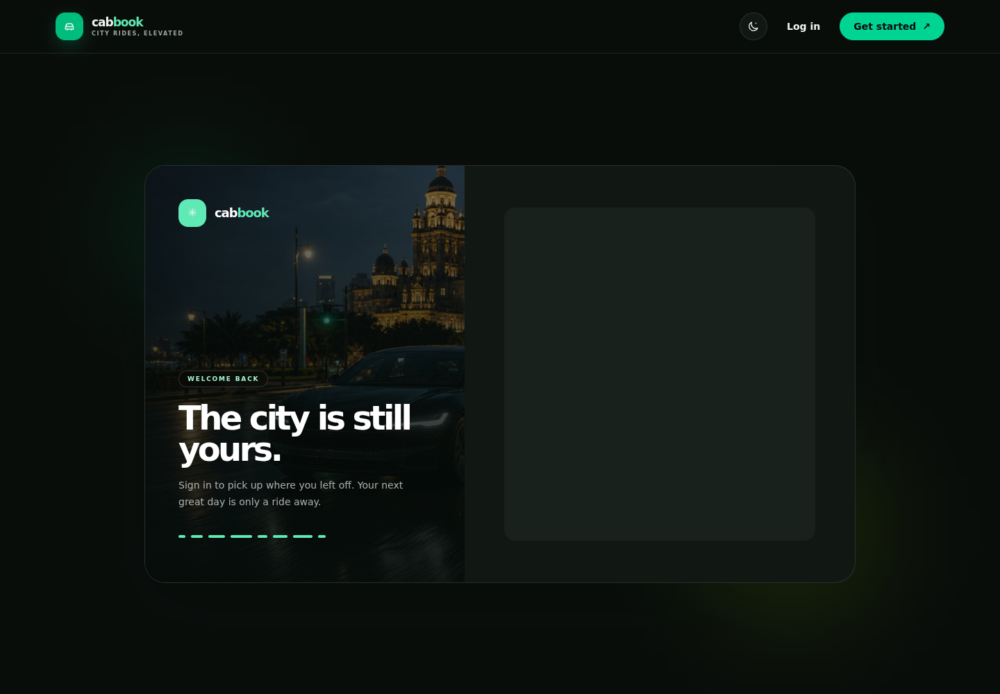
  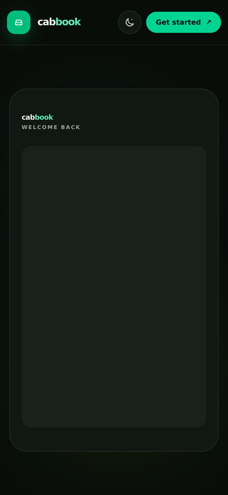
</p>

<p align="center">
  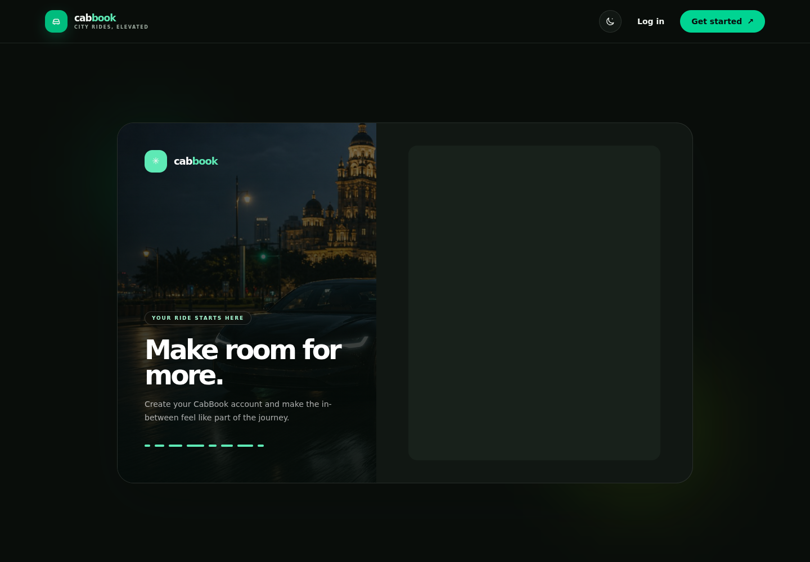
  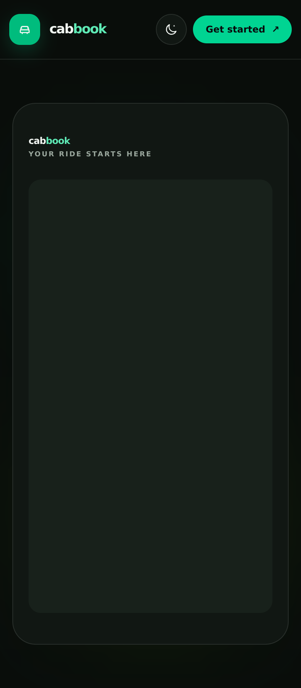
</p>

### Rider dashboard

A signed-in rider’s starting point, with account details, recent ride activity, and a shortcut to plan the next trip.

<p align="center">
  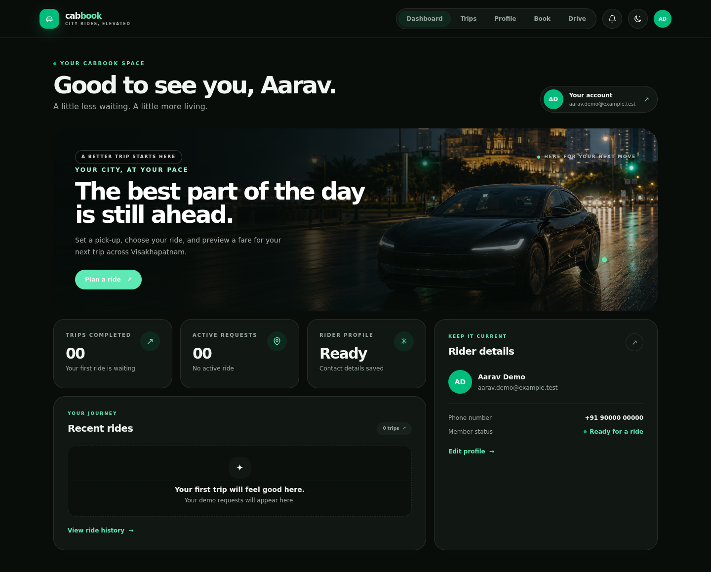
  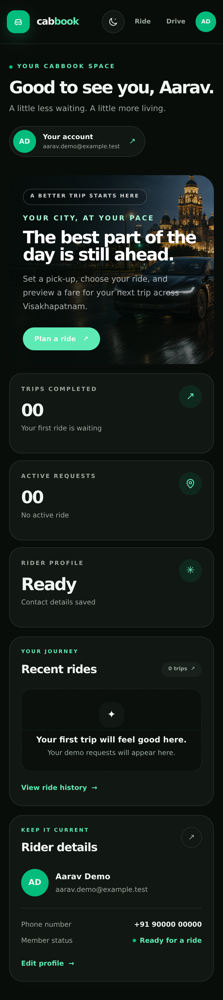
</p>

### Book a ride

Choose pickup and drop-off locations around Visakhapatnam, compare ride categories, and preview an estimated fare and road-following route. The map uses OpenStreetMap; it has a visual fallback when map tiles or routing are unavailable.

<p align="center">
  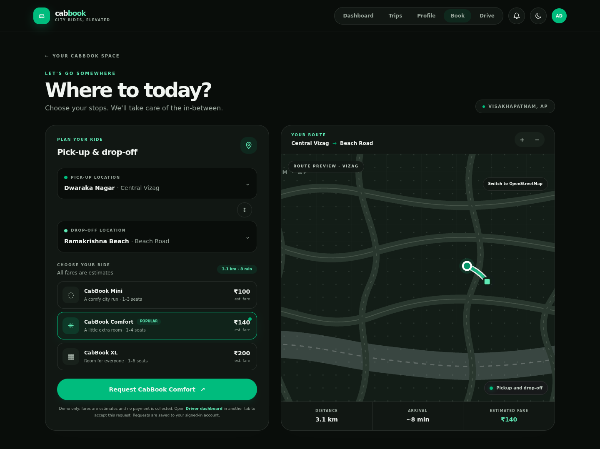
  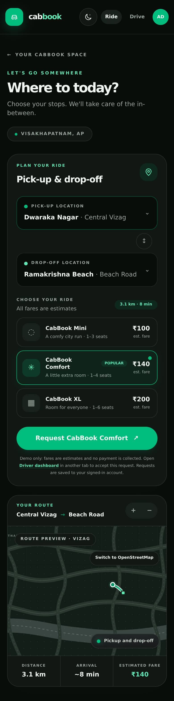
</p>

### Driver dashboard

An allow-listed demo driver can view nearby requests and accept, pass, start, or complete a trip. Newly registered accounts are riders; driver access is granted by the operator, not by choosing a role during sign-up.

<p align="center">
  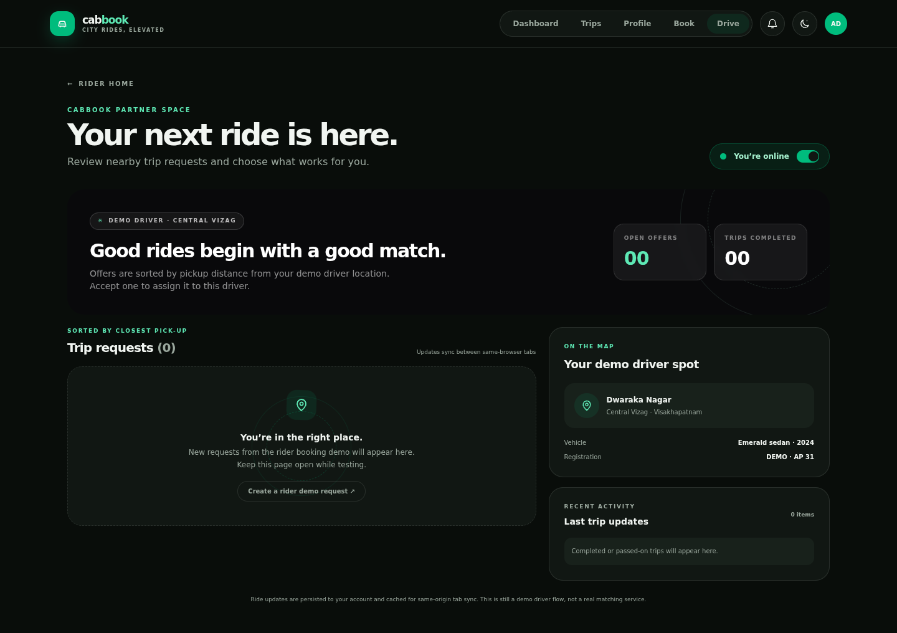
  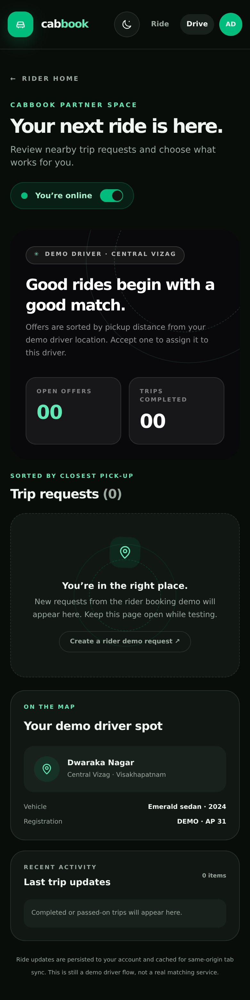
</p>

### Ride history and reviews

Review account-owned trips, search and filter by ride status, and rate completed demo rides. Reviews are limited to one per completed ride.

<p align="center">
  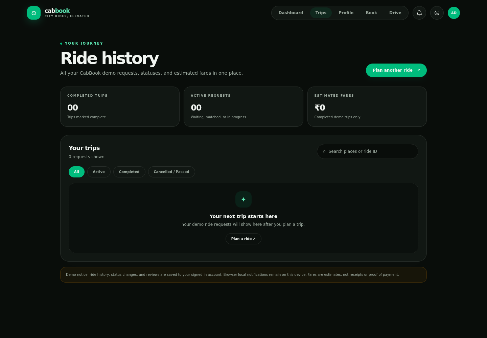
  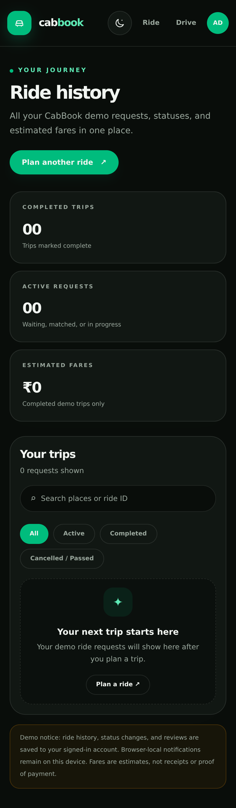
</p>

### Profile

Manage account details through Clerk, including name and profile photo. Phone verification requires phone/SMS features to be enabled in the Clerk Dashboard.

<p align="center">
  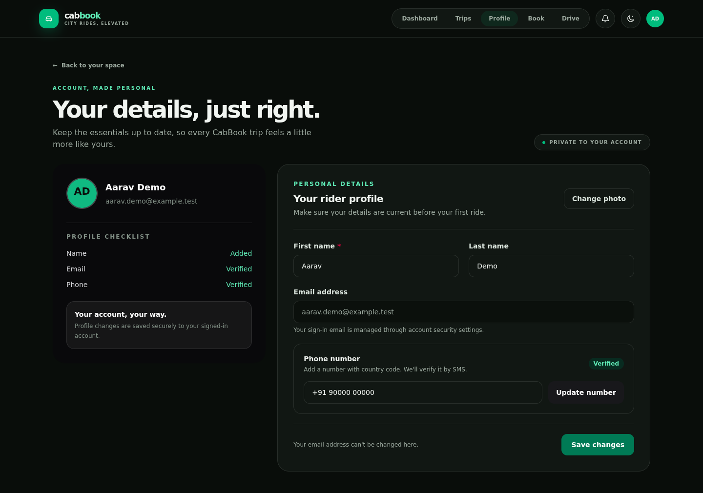
  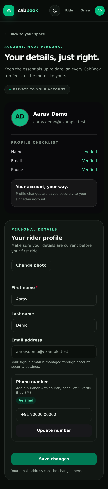
</p>

### Notifications

The account-scoped inbox shows ride updates with unread filters, read actions, pagination, and cleanup controls. Live in-app updates use authenticated same-origin WebSockets with a polling fallback. Optional browser alerts use Web Push.

<p align="center">
  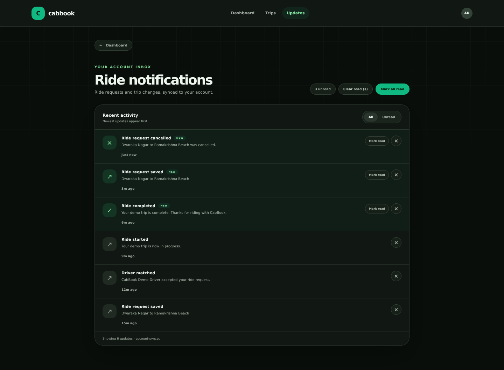
  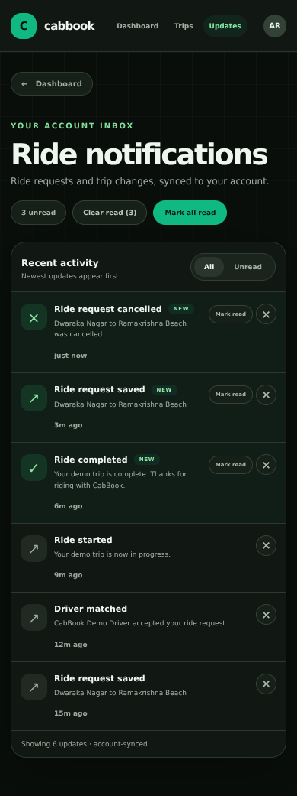
</p>

## Get started locally

### Requirements

- Node.js 20.9 or newer (Node.js 22 LTS recommended)
- npm
- A Clerk application for authentication

### 1. Install dependencies

Open a terminal in the repository root:

```bash
npm ci
```

### 2. Configure Clerk

Create a local environment file from the example:

```bash
cp .env.local.example .env.local
```

On Windows PowerShell, use `Copy-Item .env.local.example .env.local` instead. In `.env.local`, fill `NEXT_PUBLIC_CLERK_PUBLISHABLE_KEY` and `CLERK_SECRET_KEY` with the keys from the Clerk application you intend to use. Keep the secret key private and never commit `.env.local`. Configure the Clerk sign-in and sign-up routes as `/sign-in` and `/sign-up`; these paths are already set in the example file.

### 3. Set up optional operating-system alerts

Web Push is optional; in-app WebSocket delivery and polling work without it. To enable browser alerts, generate a VAPID key pair:

```bash
npm run push:vapid
```

Copy the generated `VAPID_PUBLIC_KEY` and `VAPID_PRIVATE_KEY` assignment lines into `.env.local`. Set `VAPID_SUBJECT` to a contact URI you control, such as `mailto:you@your-domain.example` or your public application URL. The example value printed by the generator is only a placeholder. **Never commit or publish the private key.**

For an imported copy of the repository, generate its own key pair. VAPID keys are local runtime configuration and are not stored in Git.

### 4. Create the local SQLite database

```bash
npm run db:migrate
```

This applies pending Drizzle migrations and creates `data/cabbook.sqlite` by default. To use a different database path, set `CABBOOK_DATABASE_PATH` in the shell before running both the migration command and the app.

### 5. Start CabBook

```bash
npm run dev
```

Open [http://localhost:3000](http://localhost:3000), then sign in or create an account using Clerk. Localhost is considered a secure browser context for notification permission and service-worker testing. For browser alerts, open **Notifications**, enable device alerts, and allow the browser permission prompt.

## Driver access

New accounts are riders by default. There is currently **no rider/driver role prompt or driver application workflow**. For this demo, an operator grants access by adding Clerk user IDs to the server-side `CABBOOK_DRIVER_USER_IDS` variable in `.env.local`:

```dotenv
CABBOOK_DRIVER_USER_IDS=user_abc123,user_def456
```

Find the ID in the Clerk Dashboard under **Users**. Restart the server after changing the allow-list, then open `/driver` while signed in as an approved driver. The allow-list is checked on the server; an empty value disables driver access. Drivers cannot accept their own ride requests, so test the queue with a separate rider account.

## Features and implementation notes

- Clerk sign-in and account-scoped rider pages.
- SQLite persistence through Drizzle ORM; ride ownership is derived from the authenticated account.
- Server-validated ride lifecycle actions, estimated distance/fares in INR, and reviews for completed trips.
- OpenStreetMap tiles with visible attribution, OSRM road-route previews, and offline map fallback. Public map services are best-effort and subject to their own usage policies.
- Allow-listed demo driver queue with atomic ride claims; it does not track driver location or provide production dispatch.
- Account-owned notification inbox with WebSocket updates, authenticated polling fallback, browser subscription management, and generic lock-screen Web Push alerts.
- Per-account ride and notification access controls; notification event text avoids exposing trip details on a lock screen.
- No payment processing or card collection. Fares are estimates only.

The local SQLite setup is intended for development or a single server with persistent storage. It is not a highly available, multi-replica database. Back up the database/volume regularly. Ephemeral or serverless hosting requires a persistent volume or a separately selected hosted database.

## Useful commands

| Command | Purpose |
| --- | --- |
| `npm run dev` | Start the development server, including the WebSocket upgrade handler |
| `npm run build` | Build the production app and prepare the standalone server |
| `npm run start` | Run the production standalone server |
| `npm run lint` | Run ESLint |
| `npm test` | Run ride, database, API/privacy, WebSocket, Web Push, and service-worker tests |
| `npm run db:generate` | Generate a Drizzle migration after a schema change |
| `npm run db:migrate` | Apply pending SQLite migrations |
| `npm run db:studio` | Open Drizzle Studio |
| `npm run push:vapid` | Generate local Web Push VAPID keys |

Run the main checks before submitting changes:

```bash
npm test
npm run lint
npm run build
```

## Self-hosting with Docker Compose

Docker Compose is provided for a single self-hosted instance with persistent SQLite storage. Create `.env` from the example, fill the Clerk values, and add VAPID settings there if browser push is required. The public Clerk publishable key is used at build time; Clerk secret, WebSocket signing secret (optional), and VAPID values are runtime configuration.

```bash
cp .env.local.example .env
# Edit .env locally; never commit real secrets.
docker compose up --build -d
docker compose ps
```

Use `docker compose logs -f web` to inspect service logs and `docker compose down` to stop the service without removing the database volume. `docker compose down -v` deletes the volume and its stored ride data. Terminate public traffic at a maintained HTTPS reverse proxy; do not expose the app directly to the internet without TLS and appropriate network controls. Configure secure backups and recovery before relying on stored data. The public OpenStreetMap tile service is intended for light use; production traffic may require a suitable tile provider or self-hosted tiles.

## Project structure

```text
src/app/                  Next.js pages and authenticated API routes
src/components/           Booking, map, dashboard, driver, profile, and inbox UI
src/lib/server/           SQLite access, authorization, WebSockets, and push delivery
drizzle/                  SQLite schema migrations
public/sw.js              Web Push service worker
scripts/                  VAPID generation and standalone build preparation
tests/                    Unit and integration tests
docs/screenshots/          Dark-mode desktop and mobile UI screenshots
```
